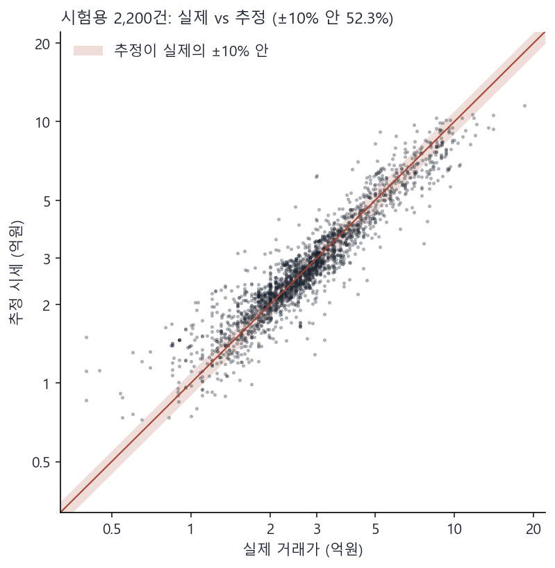
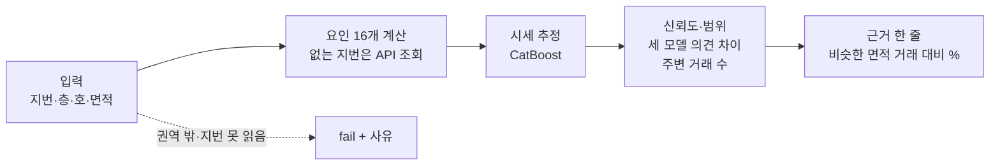
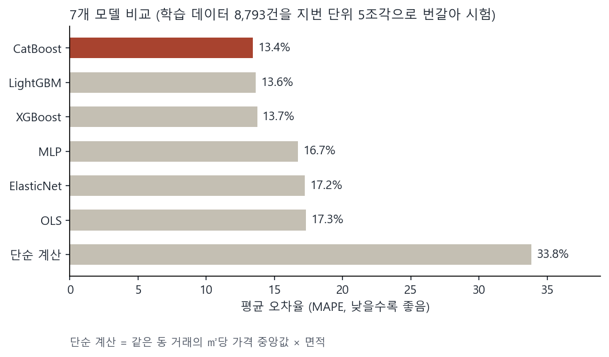
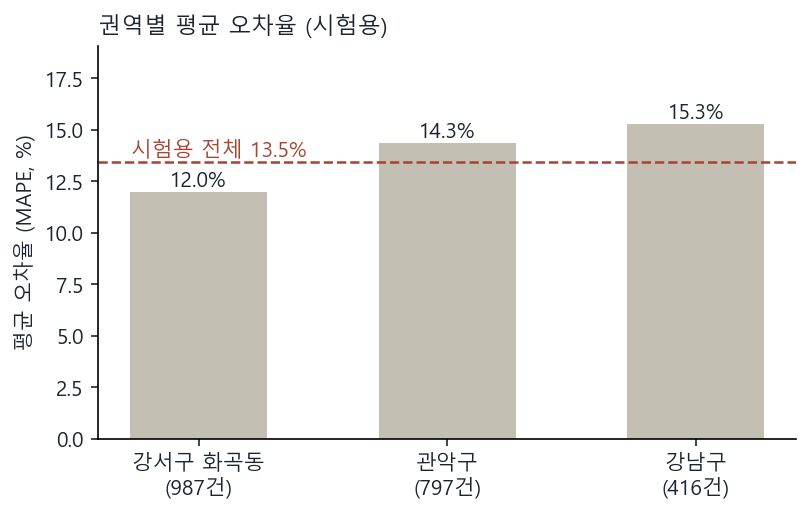

# 다세대(빌라) AI 시세 모델

서울 **강남구·관악구·강서구 화곡동** 다세대주택의 지번·층·호를 넣으면 시세, 범위, 신뢰도, 근거 한 줄이 나옵니다. (스카이키 과제, 연립 제외)

> **v2 브랜치 = 제출 뒤 개선판.** 요인에 위치(위도·경도)와 같은 건물 비슷한 면적 과거 시세를 더하고 다시 튜닝했습니다. 제출본은 `main` 브랜치입니다. 무엇을 왜 바꿨는지는 `결정기록.md` 19번에 있습니다.

| 시험 표본: 2,200건 (학습에 안 쓴 지번 20%) | 평균 오차율 (MAPE) | 중앙값 오차율 | 실제 가격이 범위 안 |
|---|---|---|---|
| **v2 (이 브랜치)** | **13.5%** | 9.4% | 82.3% |
| 제출본 (`main`) | 14.6% | 9.8% | 83.2% |



## 실행

```bash
pip install -r requirements.txt
python predict.py --input input.csv --output output.csv
```

- 예시: `sample/input_sample.csv` → `sample/output_sample.csv` (21건 약 30초)
- 산출 기준일 기본값은 과제 안내일 2026-10-06 (`--base-date`로 변경)
- 받아 둔 지번(5,317개)은 API 키 없이 동작. 처음 보는 지번만 키가 필요 (아래 "API 키")

## 시세가 나오는 순서



- 요인: 주변 거래 ㎡당 가격, 거래 시점, 동, 역까지 거리, 노선 수, 전용면적, 층, 건물 나이, 세대수, 승강기, 세대당 주차, 구조, 공시가격 (고른 이유: `결정기록.md` 4·6번)
  + v2: 위도, 경도, 같은 건물 비슷한 면적(±20%) 과거 거래 ㎡당 가격 (기준일 전 거래만, 트리 모델에만 사용. 고른 방법: `결정기록.md` 19번)
- 신뢰도 = 실제 가격이 추정의 ±10% 안에 들 확률

## 성능





- 시험용 숫자는 학습용 8,793건으로만 학습한 모델의 결과입니다. 실제 산출 모델은 그 뒤 시험용까지 합쳐 10,974건으로 다시 학습했습니다.
- 회귀 모델(OLS·ElasticNet·MLP)은 v2 요인을 넣지 않아 제출본 결과 그대로입니다 (위경도는 직선 관계가 아니고, 같은 건물 시세는 빈칸이 남아 있음).
- 자세한 결과: `reports/test_report.html`

## 사용 데이터

| 파일 (`data/raw/`) | 출처 | 건수 |
|---|---|---|
| `trades_rh.csv` | 국토교통부 연립다세대 매매 실거래 (2023.10 ~ 2026.10) | 15,637건 → 다세대 11,022건 |
| `building_title.csv` | 국토교통부 건축HUB 건축물대장 표제부 | 5,304지번 |
| `geocode_jibun.csv` | VWorld 지오코더 (지번 → 좌표) | 5,317지번 |
| `house_price_2023~2026.csv` | VWorld 공동주택가격 (연도별 공시가격) | 2026년 5,292지번 |
| `subway_stations.csv` | 서울 열린데이터광장 서울시 역사마스터 정보 (OA-21232) | 784행 |

## 폴더 구조

```
predict.py          실행 파일
requirements.txt    라이브러리 버전 (Python 3.13.7)
src/                수집 → 요인 → 전처리 → 모델 → 신뢰도 → 근거 문장 코드
data/raw/           수집 원본
data/processed/     가공 데이터 (전처리, 학습·시험 분할 등)
reports/            단계별 HTML 리포트, 모델 설정, 신뢰도 규칙
docs/img/           README 그림 (src/readme_figures.py로 생성)
sample/             예시 입력·출력
결정기록.md          단계별 결정과 근거
AI활용로그.md        AI에게 시킨 일, AI가 틀린 부분과 잡아낸 방법
```

<details>
<summary><b>입력·출력 칸 자세히</b></summary>

| 입력 칸 | 예시 | 비고 |
|---|---|---|
| id | 1 | |
| sigungu | 서울특별시 관악구 | |
| dong | 봉천동 | 법정동 |
| jibun | 123-45 | 산 지번은 미지원 |
| floor | 3 | 지하는 `-1`, `B1`, `지하1` 모두 가능 |
| ho | 301 | 없어도 됨. `301호`, `B01`도 공시가격 목록 표기에 맞춰 찾음 |
| area_m2 | 42.5 | 비어 있으면 공시가격 목록에서 찾고, 출처를 basis에 적음 |

| 출력 칸 | 뜻 |
|---|---|
| price_est | 추정 시세 (원, 만원 단위 반올림) |
| price_low, price_high | 실제 거래가가 이 범위에 들 확률 약 80% |
| confidence | 0~1. 실제 거래가가 추정의 ±10% 안에 들 확률 |
| basis | 근거 한 줄: 반경 500m·최근 12개월 비슷한 면적(±20%) 거래 기준가 대비 %, 공시가격의 몇 배, 건물 특징, 신뢰도 이유 |
| status | `ok` 또는 `fail` (fail이면 사유를 basis에 적음) |

fail이 되는 경우: 권역 밖 주소, 지번·층을 읽지 못함, 지번 좌표를 못 찾음, 처음 보는 지번인데 API 키가 없음

</details>

<details>
<summary><b>API 키 (처음 보는 지번을 조회할 때만)</b></summary>

환경변수로 넣거나 프로젝트 폴더의 `.env` 파일에 넣습니다.

```
DATA_GO_KR_KEY=공공데이터포털 인증키
VWORLD_KEY=VWorld 인증키
```

| 키 | 발급 방법 | 쓰는 곳 |
|---|---|---|
| `DATA_GO_KR_KEY` | [공공데이터포털](https://www.data.go.kr) → 「국토교통부_건축HUB_건축물대장정보 서비스」(15134735) 활용신청 → 마이페이지 일반 인증키. 실거래를 다시 받으려면 「국토교통부_연립다세대 매매 실거래가 자료」(15126467)도 신청 | 건축물대장, (재수집 시) 실거래 |
| `VWORLD_KEY` | [VWorld](https://www.vworld.kr) → 오픈API 인증키 발급. **서비스URL을 `http://localhost`로 등록** (다르면 `INCORRECT_KEY` 오류) | 좌표, 공시가격 |
| `SEOUL_KEY` | [서울 열린데이터광장](https://data.seoul.go.kr) 인증키 | 지하철역을 다시 받을 때만 (predict.py는 필요 없음) |

</details>

<details>
<summary><b>처음부터 다시 만들기 (순서)</b></summary>

| 순서 | 실행 | 결과 |
|---|---|---|
| 1 | `python src/collect_trades.py` | 실거래 |
| 2 | `python src/collect_geocode.py` | 좌표 |
| 3 | `python src/collect_stations.py` | 지하철역 |
| 4 | `python src/collect_buildings.py` / `python src/collect_buildings.py price 2023` (2024·2025도) | 건축물대장, 공시가격 |
| 5 | `python src/make_input.py` | 과제 입력 형식 + 정답 |
| 6 | `python src/features.py` | 요인 |
| 7 | `python src/split.py` | 학습·시험 분할 (지번 단위 20%, 난수 42) |
| 8 | `python src/eda.py` | 탐색 리포트 |
| 9 | `python src/preprocess.py` | 전처리 + 빈칸 채움 값 + 재학습 제외 id |
| 10 | `python src/compare_models.py` | 모델 7개 비교 |
| 11 | `python src/tune_models.py` | 설정값 조정(Optuna, 기록 `reports/optuna_v2.db`) + 학습 곡선 |
| 12 | `python src/select_model.py` | 최종 모델 선택 + 교차검증 예측 |
| 13 | `python src/uncertainty.py` | 범위·신뢰도 규칙 |
| 14 | `python src/basis.py` | 근거 문장 시험 |
| 15 | `python predict.py --input data/processed/test_input.csv --output reports/test_output.csv --train-only` → `python src/evaluate.py` | 시험용 평가 (`--train-only` = 학습용만으로 학습) |
| 16 | `python src/readme_figures.py` | README 그림 |

- 실행할 때마다 모델 3개를 새로 학습합니다(약 15초). 설정과 난수가 고정돼 있어 매번 같은 결과가 나옵니다.
- 학습 데이터 10,974건 = 학습용 8,793 + 시험용 2,181 (시험용 중 학습용과 같은 이상치 규칙에 걸린 19건 제외)

</details>

## 출처와 AI 활용

- 서울 열린데이터광장 서울시 역사마스터 정보(OA-21232), 공공누리 제1유형 / 국토교통부 실거래가·건축HUB(공공데이터포털) / VWorld 지오코더·공동주택가격
- 상용 시세 서비스(하우스머치 등)의 결과는 쓰지 않았습니다.
- Claude Code로 수집·전처리·모델링·문서 작성을 했습니다. AI가 틀린 부분과 잡아낸 방법은 `AI활용로그.md`, AI가 한 일과 직접 판단한 일은 `결정기록.md`에 있습니다.
